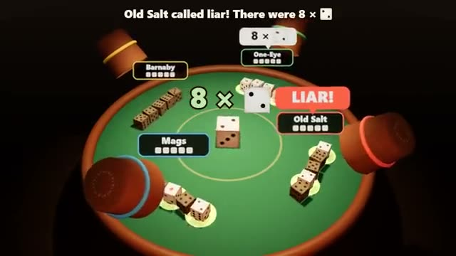

# Liar's Dice

Bluff about dice nobody else can see. A multiplayer starter game from [Multiplayer Agent](https://multiplayeragent.com): 3D, turn-based, 2–6 players, with bots that fill empty seats.

## How it plays

Everyone rolls dice under a cup and only sees their own. Take turns raising the bid on how many of one face are on the whole table (ones are wild), or call liar: whoever was wrong loses a die, and the last player with dice wins.

**Controls:** Click or tap to set a bid and press Bid or Liar; keys 2–6, up/down, Enter, L.

## Make it yours in the Game Builder

Open the [Game Builder](https://multiplayeragent.com), choose **Start from a starter game** and pick Liar's Dice. It opens as version 1 in your studio, ready to play and publish. Then ask for changes, for example:

- Add a 'spot on' call that wins a die back
- Make it a pirate ship deck at night
- Start everyone with three dice for quick games

## Run it yourself

1. Get a free publishable key (`pk_…`) at [multiplayeragent.com](https://multiplayeragent.com).
2. In `index.html`, put it in place of `pk_REPLACE_ME` in the `MP_CONNECT` block.
3. Serve the folder (for example `npx serve`) and open it. The 3D engine loads as a module, which browsers block from a file on disk.

Without a key it still runs, offline against bots.

## How it is built

- One `index.html`, plus three.js in `libs/`. The comment at the top of the script maps the code and explains the multiplayer.
- **Hidden info:** Your dice are sealed so only you can see them (the host rolls, so it can too).
- **Host-run rules:** The host's browser rolls, checks every bid and counts the dice; if it leaves, the next player takes over.
- **Bots:** Bots fill empty seats, bluff and call liar, and take over for anyone who leaves.
- **Leaderboard:** Games won, shown after every game.
- `?attract` runs it offline with bots only. The preview video is recorded from it.

## License

MIT.
